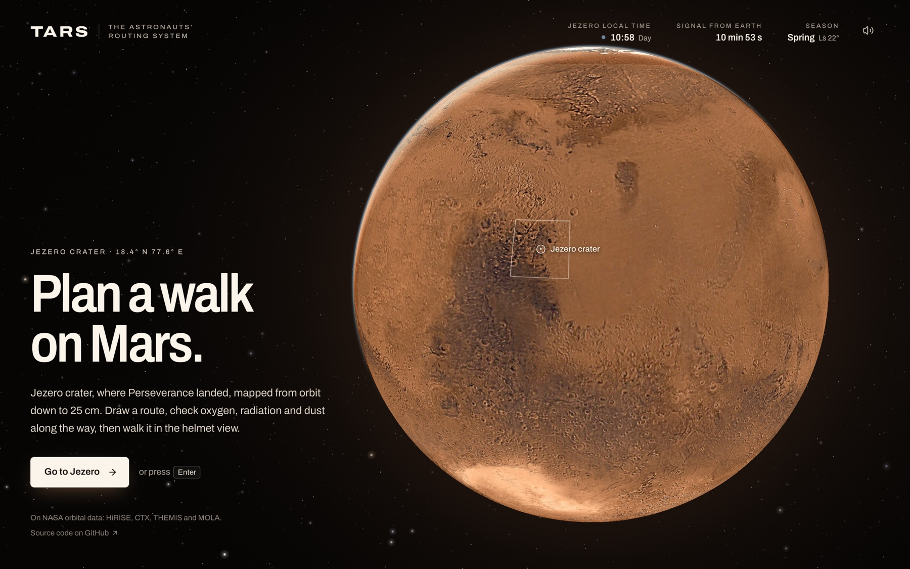
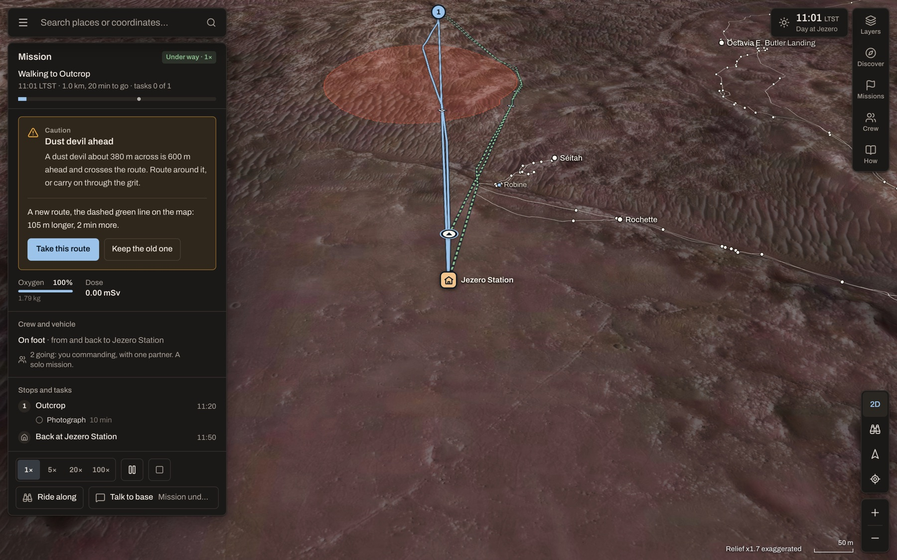
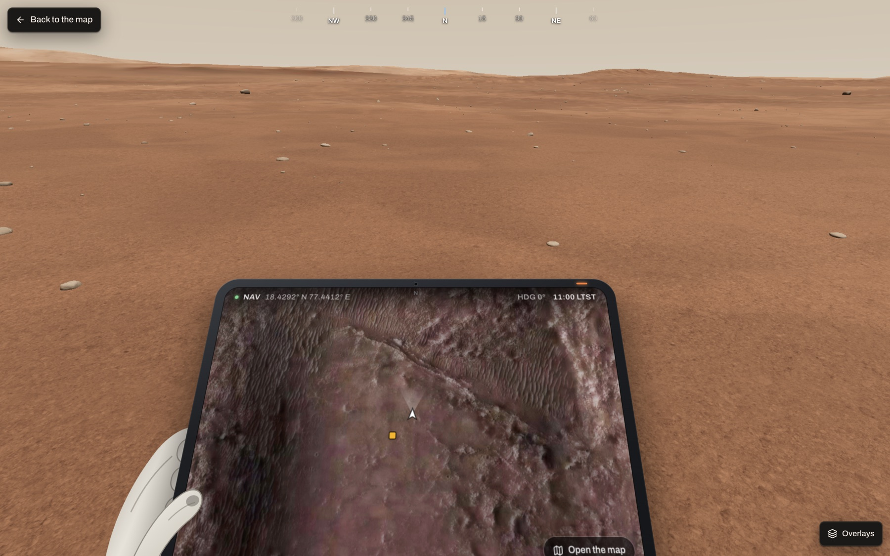
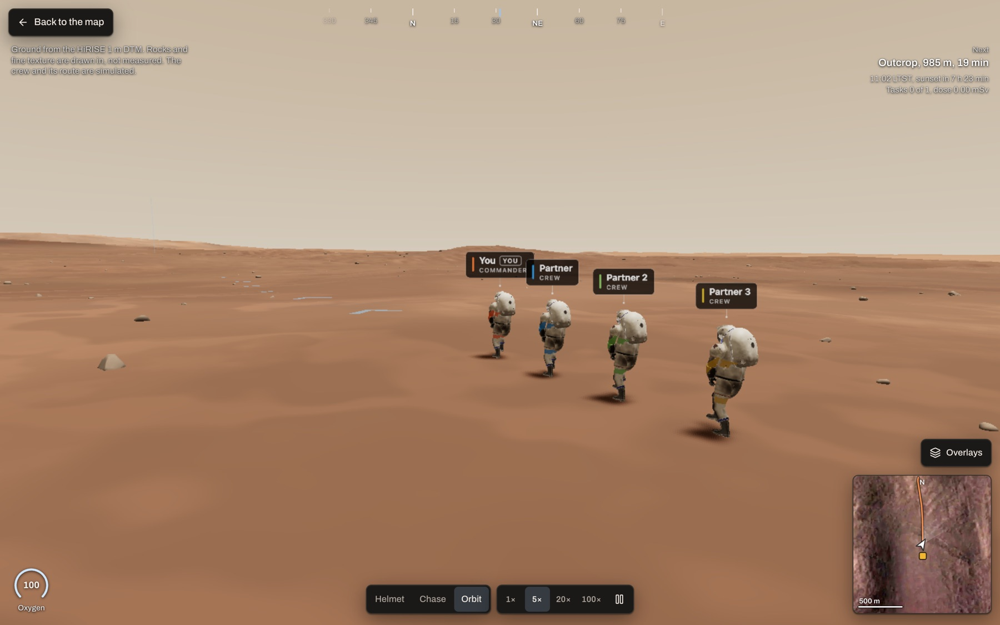

# TARS: The Astronauts' Routing System

**Plan a day of field science on Mars, on real NASA terrain.**

🔗 **Live:** https://theastronautsroutingsystem.com

Built for **NASA Space Apps Challenge 2026**, challenge *Interplanetary Survival Guide: Martian Map*,
by team **Works On My Planet**.

TARS covers Jezero crater, where Perseverance landed, and about 600 km of land around it. You choose places,
give each one science tasks, and get a route across the real terrain. TARS checks whether the crew can make the
trip safely and lets you run it. At any point you can stand on the ground and look around in 3D.



---

## Contents

- [Features](#features)
- [Run it locally](#run-it-locally)
- [Rebuild the data (optional)](#rebuild-the-data-optional)
- [Deploy](#deploy)
- [Where the data comes from](#where-the-data-comes-from)
- [Project layout](#project-layout)
- [How it was made](#how-it-was-made)
- [License](#license)

---

## Features

### 🌍 Explore Mars

- The app opens on Mars seen from orbit. It shows the local time at Jezero, the light delay from Earth and
  the season, then flies down to Jezero on the same map.
- The imagery comes from Viking, THEMIS, CTX and HiRISE. Over Jezero the map gets sharper as you zoom in,
  down to the **25 cm HiRISE mosaic** on HiRISE's **1 m elevation model**, in 3D at true scale.
- **Search** finds named features, the places Perseverance studied, its samples, and coordinates.
- **Click any spot** to open a place card. It shows the rover's own photos if it was there, a short summary,
  the geology, modelled conditions, and the latest readings from Perseverance's and Curiosity's weather stations.
- **Layers:** the USGS geologic map with its legend, two CRISM mineral maps, slope for the chosen vehicle,
  place names and Perseverance's track.
- **Discover** follows Perseverance sol by sol, with the photos it took each day, fetched from NASA.

### 🧭 Plan a mission

- A mission has a vehicle, a starting point, and stops with tasks. Drag stops to reorder them.
- Every leg is routed three ways: **safest**, **fastest** and **least effort**. The route is coloured by slope
  compared with what the vehicle can climb.
- The whole plan is stored in the URL, so you can send a mission as a link.
- Export as **GPX**, **GeoJSON** or a printable **cuff card**. You can also fly along the route and show
  walking range rings.

### 🔋 Check the plan

The trip budget shows whether a plan works:

- time, oxygen or battery, water and radiation dose
- a height profile and the **point of no return**
- a departure time: a plan made at night starts on the first morning that has enough daylight for it
- a test of the route planner against five sections of Perseverance's real drive

### ▶️ Run the mission



- **Start** runs the mission in simulated time, from 1× to 100×.
- A run panel follows the crew. Alerts come at four levels and warn before something goes wrong.
- A dust devil on the route comes with a way around it, drawn on the map before you take it. The base talks
  to the crew on the radio.
- The Mars clock checks NASA's DONKI database every 30 minutes and warns when a solar storm is forecast to
  reach Mars.

### 🥽 Rover View (3D)



- A 3D view from eye level, with the sky and light of whichever hour you choose.
- Over Jezero the ground is HiRISE's 1 m terrain covered with its 25 cm image, streamed in as you walk.
- Scroll the mouse wheel to rise up to 150 m for a drone's view.
- NASA's 3D models stand in the scene: **Perseverance** where it last reported, **Ingenuity** where it came to
  rest, and a base camp with a habitat, crew in Z-2 suits and a pressurised rover.
- **Jezero Station**: a domed hub with an airlock, two lab modules and a greenhouse.
- **Ride along** puts you with the crew during a run, with a helmet display. On foot you carry a tablet with
  the map.

### 👩‍🚀 Crews (multiplayer)



- Several people can plan and run one mission together: invites, roles, shared tasks and notes, who is
  online, android crew members, and a debrief at the end.
- Everyone shares one base. The commander's run appears live on every member's map and 3D view.
- This needs the Convex backend ([see below](#3-optional-turn-on-crews-convex)). Without it the app runs for
  one person and hides the crew features.

### 📱 On a phone

A bottom bar, one sheet that opens to three heights, and a thumb pad for walking in Rover View.

---

## Run it locally

### Requirements

| Tool | Version | Needed for |
|---|---|---|
| [Node.js](https://nodejs.org) | **22.12 or later** | The app (required) |
| npm | comes with Node | Installing packages |
| Git | any | Cloning |
| Python | 3.14 | Only for rebuilding the data, which is optional |

> The repository is about **110 MB**, because the map tiles (`public/region`, about 8,400 files) are
> included. The first clone takes a little longer, but you don't need to download anything else.

### 1. Clone and install

```bash
git clone https://github.com/wdire/theastronautsroutingsystem.git
```

```bash
cd theastronautsroutingsystem
```

```bash
npm install
```

### 2. Start the app

```bash
npm run dev
```

Open **http://localhost:5173**. That's the whole app for one person. Every feature except crews works now,
with no keys or accounts.

### 3. (Optional) Turn on crews (Convex)

Crews need a [Convex](https://convex.dev) backend. In a **second terminal**, run:

```bash
npx convex dev
```

- The first time, it asks you to log in to Convex or to use a local deployment without an account. Either
  one works.
- It pushes the `convex/` folder and writes `VITE_CONVEX_URL` to `.env.local`.
- Leave it running, then **restart `npm run dev`** so Vite reads the new URL.

### 4. (Optional) Add a NASA API key

The space weather feed works without a key, using NASA's keyless server. To use your own key:

```bash
cp .env.example .env.local
```

Then set `NASA_API_KEY` in `.env.local`. You can get a free key at https://api.nasa.gov.
Only the server function `api/spaceweather.ts` reads it; it never reaches the browser.

### Environment variables

All are optional. They go in `.env.local`, which git ignores.

| Variable | What it does | Without it |
|---|---|---|
| `VITE_CONVEX_URL` | Address of the Convex backend for crews. `npx convex dev` sets it. | The app runs solo |
| `NASA_API_KEY` | Your NASA API key for DONKI space weather | NASA's keyless server is used |

### Checks and tests

```bash
npm run check   # types, lint and unit tests
```

```bash
npm run e2e     # browser tests (Playwright)
```

Before the first e2e run, install the test browser once with `npx playwright install chromium`. The e2e tests
start the dev server on port 5173 if it isn't running already.

### All npm scripts

| Command | What it does |
|---|---|
| `npm run dev` | Dev server at http://localhost:5173 |
| `npm run build` | Type-check and build the production site into `dist/` |
| `npm run preview` | Serve the built `dist/` locally (without the `api/` functions) |
| `npm run check` | Types + lint + unit tests |
| `npm run e2e` | Browser tests |

`npm run dev` also serves the functions under `api/`, so `/api/...` works locally just as it does on Vercel.

---

## Rebuild the data (optional)

You don't need this step. The map tiles (`public/region`) and datasets (`public/data`) are already in the
repository. Rebuild them only if you want to change or refresh them.

```bash
python3.14 -m venv tools/.venv
```

```bash
tools/.venv/bin/pip install -r tools/requirements.txt
```

| Script | Builds |
|---|---|
| `tools/build_region.py` | The tile package in `public/region` (imagery and terrain from MOLA, HRSC, CTX, THEMIS, Viking) |
| `tools/build_crism.py` | The CRISM mineral layers |
| `tools/build_geology.py`, `build_names.py`, `build_sites.py`, `build_caves.py` | Geology, place names, landing sites, cave candidates |
| `tools/build_places.py`, `build_samples.py`, `build_traverse.py` | Perseverance's places, samples and track |
| `tools/build_weather.py`, `build_models.py`, `build_ground_textures.py` | Weather fallback, 3D models, close-up ground textures |
| `tools/check_region.py`, `tools/validate_data.py` | Checks for the tiles and the datasets |

Example: build the tiles, then check them:

```bash
tools/.venv/bin/python tools/build_region.py
```

```bash
tools/.venv/bin/python tools/check_region.py
```

`build_region.py` runs only the stages that haven't run yet. `--force` reruns a chosen stage.
`tools/sources.py --merge` updates the list of sources afterwards.

---

## Deploy

The app is a static site, four small server functions in `api/`, and an optional Convex backend for crews.
It is set up for [Vercel](https://vercel.com) in `vercel.json`.

1. **Crews (optional):** run `npx convex deploy` to push `convex/` to a production deployment, and copy its URL.
2. **In Vercel:** go to *Add New → Project* and import this GitHub repository. Vercel reads the framework
   (Vite), the build command and the output folder from `vercel.json`.
3. **Environment variables** (*Settings → Environment Variables*):
   - `VITE_CONVEX_URL`: the production URL from step 1
   - `NASA_API_KEY`: optional
4. **Deploy.** Every push to `main` deploys again. Add your own domain under *Settings → Domains*.

> Deploy from the Git repository, not the Vercel CLI. On the Hobby plan, the CLI's upload limit is lower than
> the 100 MB tile package.

---

## Where the data comes from

Data that changes is fetched while the app runs. Data that doesn't change ships with the app: its sources are
multi-gigabyte files that a browser can't query, and shipping it keeps the app fast.

| Data | How it arrives | How fresh |
|---|---|---|
| Space weather (solar storms, flares, particle events) | Live from NASA DONKI via `/api/spaceweather` | Checked every 30 minutes |
| Rover weather stations (Perseverance MEDA, Curiosity REMS) | Live via `/api/weather`, with `public/data/weather.json` as a fallback | Hourly. These are past measurements; NASA publishes no forecast for Mars. NASA hasn't updated the MEDA feed since April 2024 |
| Perseverance's track and stops | Live from JPL's MMGIS via `/api/traverse`, with a shipped fallback | Every 6 hours; the rover is still driving |
| Perseverance raw photos (Discover) | Live from NASA's raw images feed | On request |
| HiRISE 25 cm imagery and 1 m terrain over Jezero | Live from USGS via `/api/hirise` | Fixed products, cached for a year |
| CTX, global HiRISE and Viking detail elsewhere | Live from Esri and NASA Mars Trek tile services | Fixed products |
| Base map and terrain (`public/region`) | Shipped, built by `tools/build_region.py` | Fixed products |
| Place names, geology, caves, landing sites | Shipped in `public/data` | Rarely change |
| Named places, samples and their photos | Shipped, written from NASA's mission pages (they have no API) | Historical; the tools can add new ones |

**Sources.** All data comes from NASA and USGS: MOLA, HRSC, CTX, HiRISE, THEMIS, Viking, CRISM, the Mars 2020
terrain models, Perseverance's localisation and raw images, the IAU Gazetteer and the USGS geologic map. The
only exceptions are three CC0 close-up textures that add fine grain below what HiRISE can resolve. The
full list with licences is in [docs/data-sources.md](docs/data-sources.md).

**Modelled values.** Anything calculated from that data (temperature, dust, radiation, walking effort,
routes) is labelled *modelled* in the app. [docs/model-notes.md](docs/model-notes.md) explains how each model
works and where it stops being reliable. In Rover View the shape of the ground and the HiRISE image on it are
real; the rocks and the grain below 25 cm are generated.

NASA does not endorse this project.

---

## Project layout

```
src/engines   pure, tested models: time, conditions, vehicles, terrain, routing
src/map       the MapLibre map, the mars:// tile protocol, layers
src/planner   route planning for a mission
src/sim       running a mission in simulated time
src/net       the crew layer over Convex
src/visor     the three.js ground view (Rover View)
src/ui        panels and controls
convex/       crew backend: missions, people, the shared base, the live feed
api/          server functions: HiRISE tiles, space weather, rover weather, traverse
tools/        Python scripts that build public/region and public/data
tests/e2e/    Playwright browser tests
docs/         specification, design, progress notes, data sources, model notes
```

**Stack:** React 19, TypeScript, Vite, Tailwind, MapLibre GL, three.js, Zustand, Convex, Vercel.

---

## How it was made

- All code in this repository was written during the event, starting from an empty repository on
  **14 November 2026**.
- The code, the data tools and this document were written with **Claude (Anthropic)**, working from a
  specification and direction from the team. The team reviewed the result and decided what to keep.
- The working name was **Areo**. The specification, the progress notes and a few names in the code still
  use it.
- A team member built a learning prototype before the hackathon. None of its code or data is in this
  repository; what it taught went into the specification ([docs/build-spec.md](docs/build-spec.md)).

---

## License

The code is under the [MIT License](LICENSE). The data, imagery and 3D models keep their own terms, listed in
[docs/data-sources.md](docs/data-sources.md); most are public-domain NASA and USGS products.
